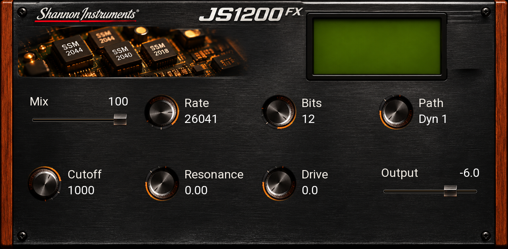

# Shannon Instruments JS1200 FX

Independent stereo effect, UID SXF1. Includes 64 built-in programs in eight groups of eight; the factory names follow the requested bank order. The DSP combines a variable-rate hold, 4–12-bit ideal quantization, drive, an output-path model derived from the instrument, dry/wet and output gain. The final output is hard-clamped to [-1, 1]; a 100% dry setting is therefore not bit-transparent at high levels.

The first two paths use SSM2044-inspired dynamic models with an amplitude-triggered envelope, which is an effect-specific approximation; paths 3–6 use the circuit-derived fixed models and 7–8 are unfiltered. The effect has no MIDI input and does not claim hardware-identical SP-1200 behavior. Its preset bank grouping is indicated by the program names; separate host-side folders are not supplied.

The green LCD is artwork unless the SDK exposes a supported preset-name binding. File32-only manifests are documented by the SDK but its official schema and validator require file64; no ARM64 is supplied. See the MIT license in src/engine/analog/md12/LICENSE for libmd12-derived components.

## TEST build and factory programs

This is an ARM32 test build, not verified on MPC hardware. The eight ordered groups are SP-1200 Classics, Boom Bap Drums, Soul & R&B, SSM Analog Filters, Digital Grit, Bass & Low End, Vintage Color, and Mixing & Mastering. They occupy contiguous groups of eight in the single VST2 program list; they are not separate folders. The exact 64 factory names and values are declared in `src/JS1200FX.cpp`. The SDK documents built-in VST2 programs as supported by the MPC preset selector; actual recall and project reload on MPC X require hardware testing.

Controls in parameter order: Mix, Rate, Bits, Path, Cutoff, Resonance, Drive and Output. Cutoff and resonance affect the two dynamic paths, not fixed or raw paths. Dynamic filter envelopes are triggered by an uncalibrated signal-level detector; this is an effect-specific model, not a circuit-exact claim. Rate reduction is a zero-order hold and bit reduction is a digital approximation. Drive raises the signal before clipping and quantization. The LCD in the background is static artwork: this SDK skin does not provide a verified binding for showing the current program name.

Install only for a supervised test: place the included `Shannon Instruments - VST - JS1200 FX` folder under `<drive>/VST2 Plugins/`, enable the SDK-documented external plugin settings, add the effect to an insert, and start with low monitor levels. Check both channels, all controls, Q-Links, preset selection, project save/reload, and CPU on the device. To roll back, remove only that FX folder and restart; projects using it will lose the effect until restored. The JS1200 instrument uses a different folder and UID.

The unmodified SDK validator currently requires a `file64` key even though the folder documentation permits ARM32-only plugins. This package intentionally has no ARM64 file. An ARM32-only adaptation of the validation check passed; the official validator did not. The included license covers the libmd12-derived filter components.

## Build

Install Python 3, Zig 0.13.0 and the [inMusic MPC Plugin Builder SDK](https://github.com/inmusic-software/mpc-plugin-builder-sdk) separately. From the SDK directory:

```sh
python3 tools/build.py /path/to/JS1200-FX --target arm32 --toolchain zig --zig /path/to/zig --no-validate
python3 tools/validate.py /path/to/JS1200-FX
python3 tools/package.py /path/to/JS1200-FX
```

The official validation command reports the ARM32-only `file64` limitation described above. Inspect the target ELF and test on the intended hardware before use. An earlier Zig-built test binary required at most GLIBC 2.27; different builds may have different requirements.



## License

JS1200 FX project contributions are MIT licensed under [LICENSE](LICENSE), copyright 2026 Shannon Instruments. Third-party code and assets retain their notices and terms; see [third_party/README.md](third_party/README.md). This project is independent and is not endorsed by inMusic, Akai, E-mu or Rossum.
